# Sistema de Diseño y Arquitectura Visual — ShioriFolio (栞 · Folio)

## Dirección actual: Reader y Biblioteca modernos (octubre de 2026)

Reader y Biblioteca usan ahora una interfaz de superficies neutras, acentos verdes y navegación sans serif. Esta dirección sustituye los tratamientos vintage de la interfaz descritos más abajo; la tipografía del contenido sigue siendo configurable y los tonos Sepia y Salvia conservan su carácter de lectura.

- **Navegación:** wordmark, pestañas redondeadas y conmutador claro/oscuro. Las pestañas permiten desplazamiento horizontal cuando falta espacio. Las herramientas de lectura aparecen en Reader.
- **Reader:** título y autor junto al historial y el ajuste de página. Capítulos permanecen a mano; anotaciones y color de PDF se agrupan en el menú de herramientas. Hoja de lectura con sombra sutil, dock de paginación y vistas, sin barra fija de estado. Los modos paginados dividen el contenido en hojas completas; el desplazamiento continuo queda reservado a su modo explícito.
- **Biblioteca:** cabecera «Tu biblioteca», importación principal, búsqueda, controles de vista y filtros ligeros. Pósteres 2:3 en una cuadrícula adaptable; títulos sans serif, progreso sobre la portada y opciones contextuales. Los libros sin imagen tienen una portada tipográfica generada con los datos reales.
- **Ajustes:** categorías Apariencia, Lectura y Atajos, con controles alineados y una sola categoría visible. Typography & Editor se retira de la navegación; la telemetría funciona en segundo plano.
- **Claro:** fondo `#F5F6F8`, superficie `#FFFFFF`, texto `#1C2430`, acento `#326B59`.
- **Oscuro:** fondo `#15181E`, superficie `#1E232B`, texto `#F0F3F6`, acento `#91CEB5`.

Los tokens efectivos están en `MeridianTheme.kt`; el chrome compartido está en `ModernReaderChrome.kt`. Las secciones siguientes conservan la referencia editorial original y la documentación de los motores de lectura.

Este documento describe la dirección de arte, los tokens de diseño, la anatomía de la interfaz (**Serene Vintage Reader** para Escritorio y Móvil Kindle) y las decisiones de arquitectura de **ShioriFolio (`shiorifolio`)**.

---

## 1. Filosofía e Identidad Visual

**ShioriFolio** fusiona dos conceptos editoriales:
- **栞 *Shiori* (Japonés)**: Marcapáginas o guía que señala el camino dentro de un libro.
- ***Folio* (Latín / Español)**: Hoja de manuscrito o pliego impreso.

La dirección estética combina:
1. **Serene Vintage Reader (Editorial & Kindle E-Ink)**: Superficies cálidas de papel sin fatiga visual, pliegos de doble página con sombra de lomo central realista, cintas marcapáginas en cola de golondrina (*Swallowtail Ribbon*) y controles flotantes translúcidos (*glass HUD*).
2. **Grabado Intaglio (*Meridian Engraving*)**: Ilustraciones vectoriales trazadas a pluma y tinta en verde salvia profundo (`#2B3A30` / `#3C4E40`), como el medallón del logotipo y el viaducto de piedra arqueado con diligencia animada.

---

## 2. Emblema y Motivos Gráficos

### 2.1 Logotipo Principal (`MeridianCompassMark` / `assets/shiorifolio-logo.svg`)
Construido sobre un lienzo vectorial `64 × 64`:
- **Anillo doble grabado**: Medallón exterior de `2.1px` y anillo interior fino de `0.8px`.
- **Libro abierto en perspectiva**: Hojas izquierda y derecha con curvatura orgánica (`cubicTo`), líneas de texto grabadas y sombreado intaglio en la página derecha.
- **Cinta marcapáginas (*Shiori* 栞)**: Cinta vertical en cola de golondrina que emerge de la base del lomo.
- **Estrella / Plumilla naciente**: Estrella de cuatro puntas con rayos grabados sobre el pliego abierto, simbolizando la luz de la lectura.

### 2.2 Cinta Marcapáginas en Cola de Golondrina (`SwallowtailBookmarkRibbon`)
- Ubicada en el borde superior derecho del pliego en escritorio y en el HUD superior en móvil.
- Color terracota/ámbar (`#984629` / `#B46B38`) con pespunte interior blanco translúcido (`alpha = 0.32`) y emblema circular central.

### 2.3 Friso del Viaducto Grabado (`MeridianViaductFooterBanner`)
- Escena animada en `Canvas` con puente de arcos de piedra y una diligencia tirada por tres caballos al trote que cruza de izquierda a derecha en un ciclo continuo de `16s`, acompañada de un hito que refleja el porcentaje de avance del libro.

---

## 3. Paletas de Color y Tonos de Pantalla (`MeridianDesign`)

El lector ofrece **4 tonos de superficie** diseñados para distintas condiciones de iluminación, definidos en [`MeridianTheme.kt`](ui/src/commonMain/kotlin/dev/meridian/folio/ui/MeridianTheme.kt):

| Token | 1. Kindle Cálido (`WHITE`) | 2. Sepia (`SEPIA`) | 3. Salvia (`SAGE`) | 4. Oscuro (`DARK`) |
| :--- | :--- | :--- | :--- | :--- |
| **`paper`** (Fondo general) | `#FCF9F3` | `#F5EDDB` | `#EEF3EE` | `#231F1C` |
| **`pageSurface`** (Hoja del folio) | `#FFFFFF` | `#FAF3E3` | `#F7FAF6` | `#2B2724` |
| **`elevatedSurface`** (Paneles / Dock) | `#F6F3ED` | `#EBE1CC` | `#E2EAE1` | `#342F2B` |
| **`ink`** (Tinta principal) | `#1C1C18` | `#2E241A` | `#203227` | `#E8E2D9` |
| **`inkSoft`** (Texto secundario) | `#424842` | `#4D3F31` | `#3D4A41` | `#C4BCB0` |
| **`muted`** (Metadatos / Pies) | `#737972` | `#7A6855` | `#647467` | `#91897E` |
| **`border`** (Reglas / Filetes) | `#EBDCCB` | `#DECBB3` | `#C8D6C9` | `#433D38` |
| **`pillBg`** (Contenedores / Chips) | `#F0EDE7` | `#E6DAC2` | `#DCE5DC` | `#38332F` |
| **`accentGreen`** (Acento primario) | `#3C4E40` | `#506855` | `#2B3A30` | `#89B093` |
| **`warningAmber`** (Cinta marcapáginas) | `#984629` | `#B46B38` | `#984629` | `#D98A54` |

### Tonos de Subrayado para Palabras y Frases (`HighlightTone`)
Cada frase guardada en el cuaderno (*Notebook / Lexicon*) puede marcarse con uno de los 4 pigmentos adaptativos (modo claro / modo oscuro):

| Tono | Etiqueta | Color Modo Claro | Color Modo Oscuro |
| :--- | :--- | :--- | :--- |
| **`SAGE`** | *Sage Ink* | `#D2DEC9` | `#2B4233` |
| **`AMBER`** | *Gilded Amber* | `#F4DF9E` | `#52431B` |
| **`TERRACOTTA`** | *Sienna Clay* | `#F2C8BC` | `#542B22` |
| **`SLATE`** | *Viaduct Slate* | `#CBD9E6` | `#243746` |

---

## 4. Sistema Tipográfico

- **Cuerpo Literario y Encabezados de Capítulo (`FontFamily.Serif`)**:
  - Inspirado en *Newsreader*, *Literata* y *Fraunces*.
  - Tamaño ajustable en vivo desde **13pt hasta 26pt** (por defecto `17pt` en vista simple y `15.8pt` en pliego de doble página).
  - Interlineado configurable en tres cadencias editoriales: **`1.5×`** (compacto), **`1.8×`** (clásico) y **`2.1×`** (estudio amplio).
- **Telemetría, Contadores de Página y Metadatos Técnicos (`FontFamily.Monospace`)**:
  - Usado en numeración de folios (`FOLIO 12`, `1-2 / 237`), porcentajes de avance (`0% — 100%`) y métricas del motor de predicción (`Ritmo: 7h 4m • 33s/pág (80 WPM)`).
- **Interfaz, Pestañas y Controles (`FontFamily.SansSerif`)**:
  - Etiquetas de navegación, botones de acción y formularios del editor.

---

## 5. Anatomía de las Vistas Adaptativas

El componente raíz [`MeridianFolioApp`](ui/src/commonMain/kotlin/dev/meridian/folio/ui/MeridianFolioApp.kt) adapta la experiencia en función del ancho de ventana (`maxWidth < 760.dp`) o mediante el conmutador manual **`📱 Kindle Móvil` / `🖥`**:

```mermaid
flowchart TD
    Root["MeridianFolioApp (BoxWithConstraints)"]
    Root -->|">= 760.dp (o modo Escritorio)"| Desktop["Vista Escritorio: Lector Inmersivo Escritorio"]
    Root -->|"< 760.dp (o toggle Kindle Móvil)"| Mobile["Vista Móvil: Lector Kindle Inmersivo Edge-to-Edge"]

    subgraph DesktopLayout["Anatomía de Escritorio"]
        D1["StitchDesktopTopNavigationBar (Logo, Libro Activo, Pestañas, Acciones)"]
        D2["Barra Auxiliar (Edición Crítica Folio, Pasajes Anotados, Capítulos)"]
        D3["Pliego de Libro Abierto (StitchBookSpreadLeaf + Sombra de Lomo + Cinta Shiori)"]
        D4["StitchFloatingCommandDock (Slider 0-100%, Ritmo WPM, 4 Vistas, 4 Tonos, Aa)"]
        D5["StitchDesktopStatusStreamBar (Reading Stream, Capítulo, Paso de Página)"]
        D1 --> D2 --> D3 --> D4 --> D5
    end

    subgraph MobileLayout["Anatomía Móvil Kindle"]
        M1["Barra de Progreso Superior Edge-to-Edge (3.dp)"]
        M2["HUD Superior Flotante Translúcido (Logo, Título, Capítulos, Cinta, Ajustes Aa)"]
        M3["Lienzo de Lectura Kindle Cálido (Encabezado Ornamental + Párrafos + Ilustraciones)"]
        M4["Hoja Desplegable: Ajustes de Lectura Kindle (4 Tonos, Tamaño A-/A+, Interlineado)"]
        M5["Píldora Flotante de Ritmo + Dock Inferior con Slider"]
        M1 --> M2 --> M3 --> M4 --> M5
    end
```

### 5.1 Los 4 Modos de Visualización (`PageViewMode`)
1. **`TWO_COLUMNS` (*Doble página*)**: Dos hojas contiguas (`currentPage` y `currentPage + 1`) dentro de una tarjeta unificada con gradiente central de pliegue de lomo (`Brush.horizontalGradient`) y línea divisoria de `1.dp`.
2. **`ONE_COLUMN` (*Simple*)**: Hoja individual centrada (`maxWidth = 820.dp`) para lectura enfocada.
3. **`WIDE` (*Ancho*)**: Hoja de lectura amplia (`72%` del ancho) acompañada a la derecha por un panel de **Marginalia & Ritmo** (`28%` del ancho) que muestra el tiempo estimado restante y las frases subrayadas en la página actual.
4. **`STRETCH` (*Stretch*)**: Lienzo expandido vertical y horizontalmente con tipografía aumentada (`+2pt`) y distribución proporcional de bloques.

---

## 6. Motor de Telemetría y Predicción (`ReadingPredictionEngine`)

Definido en [`ReadingPredictionEngine.kt`](core/src/commonMain/kotlin/dev/meridian/folio/core/ReadingPredictionEngine.kt):
- Registra ticks de lectura activa cada segundo (`recordReadingTimeTick`) y transiciones de página (`recordPageTurn`).
- Filtra pausas largas o cambios rápidos de página para evitar distorsionar el promedio.
- Combina el ritmo por página (**segundos/página**) y la densidad léxica (**palabras/minuto — WPM**) mediante una media móvil ponderada exponencialmente (**EWMA**) para recalcular en tiempo real el tiempo restante (`FinishTimePrediction`).
