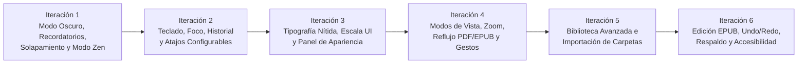

# Plan de Acción e Iteraciones — Mejoras Integrales de ShioriFolio (栞 · Folio)

Este plan organiza los **10 bloques de requerimientos** en **6 iteraciones incrementales**, siguiendo estrictamente el orden de prioridad solicitado:
1. **Errores visuales y de interacción críticos** (Modo oscuro, cierre de recordatorios, superposición de marcapáginas, Modo Zen y separación de pantalla completa).
2. **Navegación por teclado, historial y atajos personalizables**.
3. **Tipografía, nitidez, escalado y separación de ajustes UI vs. Libro**.
4. **Modos de visualización, zoom, gestos táctiles y reflujo/espaciado en EPUB y PDF**.
5. **Biblioteca avanzada ("Biblioteca") e importación/sincronización desde carpetas**.
6. **Edición no destructiva de EPUB (Undo/Redo, buscar/reemplazar, reanclaje de notas) y respaldo/accesibilidad**.

> [!WARNING]
> **Dirección visual retirada (2026-10-18):** el sistema **Serene Vintage Reader** fue eliminado del repositorio. Las referencias visuales de las iteraciones 1–4 quedan como registro histórico; la interfaz se migrará al sistema **Tactile Claymorphism** del proyecto Stitch **"Claymorphic App Redesign"** (`projects/14806878120696973328`).

> [!IMPORTANT]
> **Invariantes en todas las iteraciones**:
> - Todo nuevo campo en modelos `@Serializable` de [DocumentModels.kt](file:///c:/Users/terra/Documents/GitHub/Neuer%20Ordner/core/src/commonMain/kotlin/dev/meridian/folio/core/DocumentModels.kt) tendrá valor por defecto para no romper `~/.meridian-folio/meridian_folio_state.json`.
> - Los nuevos componentes de interfaz se extraerán en archivos modulares dentro de `ui/src/commonMain/kotlin/dev/meridian/folio/ui/` para evitar crecer [MeridianFolioApp.kt](file:///c:/Users/terra/Documents/GitHub/Neuer%20Ordner/ui/src/commonMain/kotlin/dev/meridian/folio/ui/MeridianFolioApp.kt).
> - Cada iteración cierra con compilación y pruebas en verde (`:core:desktopTest`, `:ui:desktopTest`, `:desktopApp:classes`, `:androidApp:compileDebugKotlin`).

---

## Resumen de Iteraciones

| Iteración | Puntos Cubiertos | Alcance Principal | Complejidad |
| :--- | :--- | :--- | :--- |
| **Iteración 1** | **1 (contraste), 2, 3 (folio), 6** | `MaterialTheme` oscuro/claro, cierre y cancelación de recordatorios (`Esc`/Atrás), corrección de la cinta sobre `"FOLIO"`, pliegue central oscuro y Modo Zen + Pantalla Completa desacoplados. | Media |
| **Iteración 2** | **1 (teclado e historial)** | Navegación `Tab`/`Shift+Tab` con anillo de foco, `Ctrl+Tab` entre pestañas, flechas/`PageUp`/`PageDown`, pila de historial (`Atrás` tras saltar a capítulo/búsqueda) y editor de atajos. | Media |
| **Iteración 3** | **3 (tipografía y apariencia)** | Nitidez tipográfica en pestañas/controles, escala de UI independiente, fuentes embebidas/sistema y separación de ajustes de Interfaz vs. Contenido (bloqueando fuente en PDF original). | Media |
| **Iteración 4** | **4 y 5** | 5 modos de vista (Individual, Doble, Scroll paginado, Scroll continuo, Reflujo adaptable), Zoom/Ajuste, heurística de párrafos/guiones en PDF + gancho OCR y espaciado semántico en EPUB. | Alta |
| **Iteración 5** | **7 y 8** | Renombrar *Archive* a **Biblioteca** (Tarjetas/Lista × Compacta/Detallada, búsqueda, filtros, estados, colecciones, multiselección) e importación/observación de carpetas en Desktop y Android SAF. | Alta |
| **Iteración 6** | **9 y 10** | Edición en vivo de EPUB, Buscar/Reemplazar con vista previa, Undo/Redo, reanclaje de anotaciones, validación estructural al exportar y exportación/importación de respaldo personal JSON. | Alta |

---

## Detalle por Iteración

### Iteración 1 — Correcciones Visuales Críticas, Consistencia del Modo Oscuro, Recordatorios y Modo Zen
**Cubre:** Parte visual del Punto 1 (*Imagen 1: letras negras casi invisibles en modo oscuro*), Punto 2 (*Recordatorios y Modo Zen*), parte del Punto 3 (*cinta marcapáginas tapando "FOLIO"*) y Punto 6 (*Imagen 4: centro del libro en dos columnas y páginas PDF en modo oscuro*).

1. **Contraste integral en Modo Oscuro (Imagen 1) y Consistencia del Pliego (Imagen 4)**:
   - En [MeridianTheme.kt](file:///c:/Users/terra/Documents/GitHub/Neuer%20Ordner/ui/src/commonMain/kotlin/dev/meridian/folio/ui/MeridianTheme.kt), agregar tokens semánticos `onAccent`, `disabledInk`, `disabledBg`, `focusRing` y una función `MeridianPalette.toMaterialColorScheme()` que envuelva toda la app en `MaterialTheme`. Esto corrige de raíz el texto negro ilegible en `OutlinedTextField`, `Button`, `OutlinedButton` y `Slider` durante el modo oscuro.
   - Corregir el gradiente del pliegue central (`TWO_COLUMNS`) y los contenedores vacíos en [MeridianFolioApp.kt](file:///c:/Users/terra/Documents/GitHub/Neuer%20Ordner/ui/src/commonMain/kotlin/dev/meridian/folio/ui/MeridianFolioApp.kt) para que usen `palette.pageSurface` y sombras derivadas del tema activo sin dejar franjas claras en el centro del libro (*Imagen 4*).
   - En páginas PDF renderizadas como imagen, añadir un control independiente de **Transformación de color de página PDF** (`Original`, `Tinte del Tema`, `Invertir Inteligente para Noche` preservando ilustraciones).
2. **Corrección del Editor de Recordatorios (Punto 2)**:
   - Agregar botón explícito **`Cancelar / ✕`** en `PageReminderBanner` que descarte los cambios temporales en memoria sin guardar.
   - Soportar cierre con tecla `Esc` en Windows/Linux y con `BackHandler` (botón/gesto Atrás) en Android.
3. **Corrección del Solapamiento de la Cinta Marcapáginas sobre `"FOLIO"` (Punto 3)**:
   - En `StitchBookSpreadLeaf`, reservar margen derecho (`padding(end = 42.dp)`) en la cabecera de la hoja derecha y posicionar `SwallowtailBookmarkRibbon` en el margen exterior del pliego para que jamás se superponga con el texto `"FOLIO N"` ni al reducir la ventana.
4. **Modo Zen vs. Pantalla Completa de Plataforma (Punto 2)**:
   - Separar en dos estados independientes:
     - **Ocultar controles (Modo Zen)**: oculta barra superior, barra auxiliar, dock flotante y barra de estado inferior para que las hojas del libro se expandan al 100 % del área útil. Incluye píldora discreta/toque en bordes o atajo (`Z` / `Esc`) para restaurar controles.
     - **Pantalla completa del sistema (`F11`)**: conectada a `WindowPlacement.Fullscreen` en [Main.kt](file:///c:/Users/terra/Documents/GitHub/Neuer%20Ordner/desktopApp/src/main/kotlin/dev/meridian/folio/desktop/Main.kt) y a `WindowInsetsControllerCompat` en [MainActivity.kt](file:///c:/Users/terra/Documents/GitHub/Neuer%20Ordner/androidApp/src/main/kotlin/dev/meridian/folio/android/MainActivity.kt).

---

### Iteración 2 — Navegación por Teclado, Historial de Saltos y Atajos Personalizables
**Cubre:** Punto 1 completo (*Navegación por teclado y controles en Windows y Linux*).

1. **Recorrido de Controles (`Tab` / `Shift + Tab`) e Indicador de Foco**:
   - Crear modificador reutilizable `Modifier.shioriFocusable(palette)` en `ui/src/commonMain/kotlin/dev/meridian/folio/ui/KeyboardNavigation.kt` con borde de foco de alto contraste (`2.dp`, `palette.focusRing`) y rol semántico accesible para todos los botones, pestañas y chips.
2. **Guardia de Campos de Texto**:
   - Registrar el estado de foco de edición de texto (`isTextInputFocused`) para que ningún atajo de lectura de una sola tecla o de flechas se dispare mientras el usuario escribe en un `OutlinedTextField` (búsqueda, notas, editor, recordatorios).
3. **Atajos Globales y de Lectura Configurables**:
   - `Ctrl + Tab` y `Ctrl + Shift + Tab`: cambiar a la pestaña siguiente/anterior.
   - `←` / `→` y `Page Up` / `Page Down`: retroceder/avanzar página respetando el paso del modo activo (`1` en simple/scroll, `2` en doble página).
   - Atajos dedicados para alternar **Modo Zen**, **Pantalla Completa**, **Modo de Vista** y **Volver en el Historial (`Alt + ←` / `Backspace`)**.
   - Panel en **Configuración → Atajos de Teclado** para consultar, reasignar teclas y restaurar valores por defecto, persistidos en `FolioPersistedState`.
4. **Historial de Navegación (Diferenciado del Cambio de Página)**:
   - Implementar una pila `navigationBackStack: List<ReadingLocation>` en `FolioRepository`.
   - Cuando el usuario avanza página normalmente (`←`/`→`), no se contamina el historial; cuando salta desde el **Índice de Capítulos (TOC)**, un **enlace interno**, un **marcapáginas** o un **resultado de búsqueda/cuaderno**, se empuja la página previa al historial y aparece un botón flotante **`↩ Volver a pág. X`** (además del atajo `Alt + ←`).

---

### Iteración 3 — Tipografía, Nitidez, Escala de Interfaz y Sección de Apariencia
**Cubre:** Punto 3 completo (*Imagen 2: títulos de pestañas pixelados, sección de Apariencia y separación UI vs. Contenido*).

1. **Corrección del Renderizado Tipográfico (Imagen 2)**:
   - Sustituir en los títulos de pestañas y controles pequeños el uso de `FontFamily.Serif` en tamaños reducidos por tipografía `SansSerif` con pesos `Medium`/`SemiBold`, `letterSpacing` calibrado y tamaños mínimos legibles (`>= 13.sp` en pestañas principales) para eliminar el aspecto dentado/pixelado en monitores Windows y Linux.
2. **Separación Estricta: Ajustes de Interfaz vs. Ajustes de Contenido del Libro**:
   - Crear `UiAppearanceSettings` (fuente de UI, tamaño base de UI, peso tipográfico, alto contraste y **escala global de la interfaz** `85% – 135%` mediante `CompositionLocalProvider(LocalDensity)`).
   - Crear `BookTypographySettings` (fuente de lectura, tamaño `pt`, interlineado, separación entre párrafos `dp`, márgenes horizontales/verticales y alineación `Izquierda` / `Justificada`).
   - En **PDF en vista original**, deshabilitar/ocultar los controles de fuente/interlineado de texto adaptable (mostrando en su lugar controles de zoom, ajuste de página y modo de color de página), habilitándolos únicamente cuando el PDF esté en **Modo de Texto Adaptable (Reflujo)** o cuando el documento sea un **EPUB**.
   - Botón **Restaurar valores predeterminados** tanto para UI como para lectura.

---

### Iteración 4 — Modos de Visualización, Zoom, Gestos en Android y Reflujo / Espaciado (PDF y EPUB)
**Cubre:** Puntos 4 (*Modos de visualización*) y 5 (*Imagen 3: espacios excesivos entre párrafos y saltos de página*).

1. **5 Modos de Visualización + Zoom y Ajuste (Recordados por Libro)**:
   - Expandir `PageViewMode` y persistir la preferencia + posición exacta **por cada libro** (`BookReadingPreferences`):
     1. `SINGLE_PAGE` (*Página individual*).
     2. `TWO_PAGE_SPREAD` (*Doble página*).
     3. `VERTICAL_PAGINATED` (*Desplazamiento vertical por páginas* con separación clara de hoja).
     4. `VERTICAL_CONTINUOUS` (*Desplazamiento vertical continuo* para lectura corrida sin cortes bruscos).
     5. `REFLOW_TEXT` (*Texto adaptable / reflujo*).
   - Controles de escala de página: **Ajustar al ancho**, **Ajustar a la página** y **Zoom manual** (`50% – 250%`).
2. **investigación y Solución de Espacios entre Párrafos y Saltos de Página (Imagen 3)**:
   - **Causa raíz identificada en el código actual**: en [PlatformPdfEngine.desktop.kt](file:///c:/Users/terra/Documents/GitHub/Neuer%20Ordner/core/src/desktopMain/kotlin/dev/meridian/folio/core/PlatformPdfEngine.desktop.kt), cada página física del PDF se corta y los saltos de línea o encabezados/pies repetidos generan bloques `PARAGRAPH` truncados con espaciado fijo entre bloques y entre páginas.
   - **En EPUB**: normalizar estilos CSS/HTML excesivos al parsear en [DocumentCodec.kt](file:///c:/Users/terra/Documents/GitHub/Neuer%20Ordner/core/src/commonMain/kotlin/dev/meridian/folio/core/DocumentCodec.kt), permitiendo al usuario regular la separación entre párrafos (`4.dp – 24.dp`) mientras se preservan los divisores semánticos de escena (`* * *`, `
`) y cambios de capítulo.
   - **En PDF (Modo Original vs. Modo Texto Adaptable)**:
     - Mantener el **Modo Original** fiel a la maquetación de cada página del PDF.
     - Implementar `PdfReflowEngine` para el **Modo Texto Adaptable**: une párrafos cortados entre el final de una página y el inicio de la siguiente, une palabras divididas por guion al final de línea (`-\n`), filtra encabezados/pies de página repetitivos (números de página solitarios o títulos idénticos en margen superior/inferior) y detecta páginas con tablas/multicolumna o baja fiabilidad mostrando un aviso con botón directo **"Volver a Vista Original"**.
     - **Soporte para PDF escaneado (OCR)**: detectar páginas sin capa de texto (`wordCount == 0` con imagen presente) y ofrecer extracción OCR bajo demanda (integrando detector de `tesseract` CLI en Desktop si está instalado en el sistema y proveedor enchufable en Android) sin alterar el archivo PDF original.
3. **Adaptación Táctil en Android**:
   - Adaptar barras y docks a orientación vertical y horizontal.
   - Separar las zonas de toque en los bordes (para pasar página en modos paginados) de los gestos de **selección de texto** (pulsación larga) y **desplazamiento vertical / pellizco para zoom**, evitando cambios de página accidentales.

---

### Iteración 5 — Biblioteca Avanzada ("Biblioteca") e Importación / Observación de Carpetas
**Cubre:** Puntos 7 (*Importación desde una carpeta*) y 8 (*Convertir "Archive" en Biblioteca — Imagen 5*).

**Estado de implementación (18 de octubre de 2026):** implementada. Modelos y operaciones en `LibraryModels.kt` y `LibraryManager.kt`; interfaz modular en `LibraryWorkspace.kt`; adaptadores de carpeta Desktop y Android mediante `PlatformLibraryIo`.

- Tarjetas/lista × compacta/detallada, búsqueda, filtros combinables, ordenación, estados, colecciones N:M y acciones en lote.
- Escaneo en `Dispatchers.IO`, deduplicación SHA-256/ruta canónica (incluidos libros anteriores), errores por archivo, detección de ausentes y recuperación sin perder datos de lectura.
- Selector de carpetas y `WatchService` opcional en Desktop; `OpenDocumentTree`, permisos persistentes y actualización al reanudar en Android.
- Quitar libros conserva los archivos y evita su reimportación automática en la próxima sincronización. La importación explícita permite reincorporarlos. El borrado físico tiene confirmación independiente y conserva el registro si falla.
- La sincronización conserva el contenido editado del lector. La acción **Recargar** sustituye ese contenido desde el archivo vinculado tras confirmación, manteniendo identidad, progreso, colecciones y anotaciones.
- Verificación automatizada: `:core:desktopTest`, `:ui:desktopTest`, `:desktopApp:classes` y `:androidApp:compileDebugKotlin`. Capturas de las cuatro variantes en modo oscuro en `ui/build/library-*-dark.png`.
- Pendiente de validación manual: selector SAF, permisos y reanudación en un dispositivo Android; comportamiento del observador en Linux.

1. **Importación y Sincronización desde Carpeta (Punto 7)**:
   - En **Configuración / Biblioteca**, permitir agregar una o varias carpetas vigiladas (`WatchedFolder`: ruta/URI, opción `incluir subcarpetas`, última sincronización).
   - Escaneo asíncrono en segundo plano (`Dispatchers.IO`) con barra de progreso no bloqueante (`ImportProgressState`: archivo actual, procesados/total).
   - Deduplicación por huella SHA-256 / ruta canónica.
   - Manejo de errores por archivo dañado o inaccesible sin abortar el lote; si un archivo desaparece del disco, marcar el libro como **`No disponible en disco (`isMissingOnDisk = true`)`** conservando intactos su progreso, recordatorios, colección y anotaciones.
   - En Windows/Linux, observador opcional `WatchService` en hilo demonio; en Android, integración con `OpenDocumentTree` (SAF) y actualización segura al reanudar o pulsar *Actualizar*.
2. **Transformar "Archive" en "Biblioteca" (Punto 8 — Imagen 5)**:
   - Renombrar la pestaña *Archive* a **Biblioteca**.
   - Implementar las **4 variantes de visualización**:
     - **Vista de Tarjetas Compacta (Imagen 5)**: cuadrícula de portadas con esquinas suavemente redondeadas, sombra editorial sutil y título debajo (con generador de portada tipográfica grabada cuando el libro no tenga imagen de portada).
     - **Vista de Tarjetas Detallada**: portada + insignia `PDF`/`EPUB`, barra y porcentaje leído, páginas totales (indicando *"págs. estimadas"* en EPUB adaptable) y tiempo estimado restante (distinguiendo *"Según tu ritmo"* vs. *"Estimado inicial"*).
     - **Vista de Listado Compacta y Detallada**: filas tabulares legibles con acceso rápido.
   - **Búsqueda, Filtros, Ordenación, Estados y Colecciones**:
     - Búsqueda instantánea por título y autor.
     - Filtros combinables por **Estado** (`Pendiente`, `Leyendo`, `Abandonado`, `Terminado`), **Formato** (`PDF`/`EPUB`), rango de progreso, cantidad de páginas y fechas de incorporación/finalización.
     - Orden ascendente/descendente por título, autor, progreso, páginas, fecha de adición o última lectura.
     - **Colecciones personalizadas** (`N:M`: un libro puede estar en varias colecciones sin duplicar archivo).
     - **Barra de Selección Múltiple**: cambiar estado en lote, asignar/quitar colecciones o eliminar.
     - Diálogo de eliminación con distinción explícita entre **"Quitar de la biblioteca (conservar archivo en el dispositivo)"** y **"Eliminar también el archivo del disco"** (con confirmación).

---

### Iteración 6 — Edición y Anotación Avanzada de EPUB, Persistencia y Accesibilidad
**Cubre:** Puntos 9 (*Edición y anotación de EPUB*) y 10 (*Persistencia, respaldo, accesibilidad y verificación*).

**Estado de implementación (18 de octubre de 2026):** implementada. La edición vive en el estado del lector; el archivo EPUB original nunca se modifica y los cambios se materializan al exportar.

- Motores de dominio en `BookEditing.kt` (buscar/reemplazar, reanclaje por prefijo/frase/sufijo/capítulo, renombrado/reordenado/reparación de capítulos), historial por sesión en `EditHistory.kt`, respaldo en `BackupModels.kt`/`BackupCodec.kt` y validación estructural en `EpubExportValidator.kt` con `PlatformTooling` (*epubcheck* opcional).
- Interfaz de edición en `EditingWorkspace.kt`: buscar/reemplazar con vista previa (capítulo o libro completo), corrección de palabras/párrafos, gestión de capítulos, metadatos (título, autor, idioma, portada) y reanclaje de anotaciones. En escritorio, acciones en la barra superior; en móvil, menú «✎» en el HUD.
- Deshacer/Rehacer por libro con instantáneas (documento, anotaciones y recordatorio), expuesto como `editHistoryState`; atajos `Ctrl+Z` y `Ctrl+Y` reasignables.
- Anotaciones huérfanas señaladas en el cuaderno con acción **Reanclar**: cuando el ancla no puede resolverse con confianza, la nota se marca en lugar de moverse en silencio.
- Exportación regenera `content.opf`, `nav.xhtml`/`toc.ncx`, `dc:language` y portada incrustada; cada export se valida (estructura + `epubcheck` cuando está instalado). La importación lee `dc:language`; `DocumentCodec.CURRENT_PARSER_VERSION = 5` re-analiza una vez los libros guardados.
- Respaldo portátil `.json` (exportar/importar desde **Ajustes → Datos**): los libros se reasocian por huella SHA-256, las colecciones por nombre y los libros ausentes se informan sin eliminar nada. E/S de respaldo en `Dispatchers.IO`.
- Verificación automatizada: `EditingIntegrationTest` (core, 11 pruebas) y `EditingUiTest` (UI, 6 pruebas) sobre la suite completa — `:core:desktopTest` (23), `:ui:desktopTest` (23), `:desktopApp:classes` y `:androidApp:compileDebugKotlin` en verde.
- Pendiente de validación manual: selectores SAF de respaldo en Android (hoy usa el diálogo de ruta tipada, igual que importar/exportar), y ejecución real de `epubcheck` en un entorno que lo tenga instalado.

1. **Separación de Capas y Edición Gradual de EPUB (Punto 9)**:
   - Separar claramente en el modelo de datos:
     1. **Preferencias de visualización por libro** (`BookReadingPreferences`).
     2. **Anotaciones del lector** (resaltados, notas, marcapáginas con panel unificado de consulta).
     3. **Modificaciones del contenido del libro** (corrección de palabras/párrafos desde el lector, edición de metadatos: título, autor, idioma, portada; edición de títulos de capítulos, reparación de TOC y reordenación de capítulos).
   - **Buscar y Reemplazar**: alcance por capítulo actual o libro completo, con **vista previa de coincidencias** antes de confirmar.
   - **Pila Deshacer / Rehacer (`Undo / Redo`)** por sesión de edición y conservación intacta del archivo EPUB original en disco.
   - **Reanclaje de Anotaciones**: cada resaltado/nota guarda ancla de contexto (`prefix`, `exactPhrase`, `suffix`, `chapterId`). Cuando el texto cambia, se reubica automáticamente; si el pasaje fue eliminado, la nota se marca como *Huérfana / Para revisión* en el panel de notas sin perderse.
   - **Exportación de Copia Modificada y Validación**: al exportar a `.epub`, regenerar `content.opf`, `toc.ncx` / `nav.xhtml` actualizando referencias internas y ejecutar un validador estructural integrado (y soporte para invocar `epubcheck` si está disponible en el entorno).
2. **Respaldo Portátil, Rendimiento y Verificación Final (Punto 10)**:
   - **Exportar / Importar Datos Personales (`.shiorifolio-backup.json`)**: paquete portátil con progreso, telemetría, recordatorios, resaltados/notas, colecciones, atajos y preferencias para respaldo o transferencia entre Windows, Linux y Android.
   - Revisión final de etiquetas semánticas (`contentDescription`), tamaños mínimos de control táctil (`48.dp` en Android) y fluidez con documentos grandes.
   - Ejecución de la suite completa de pruebas automatizadas y verificación cruzada.
